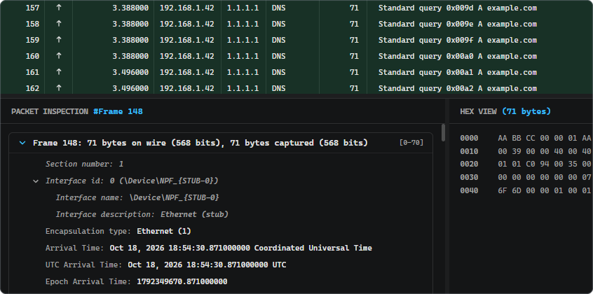
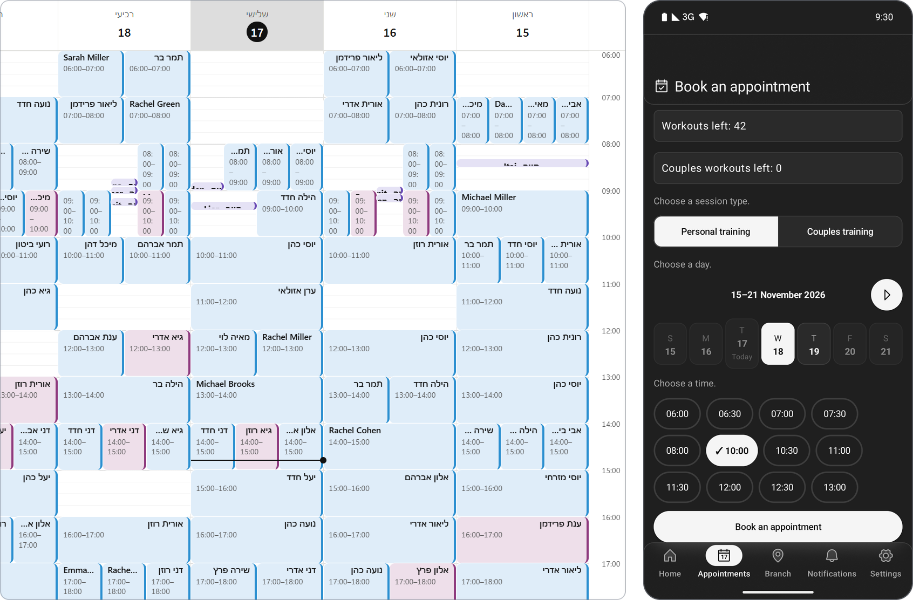
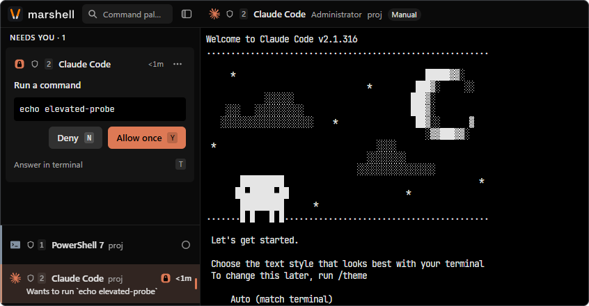
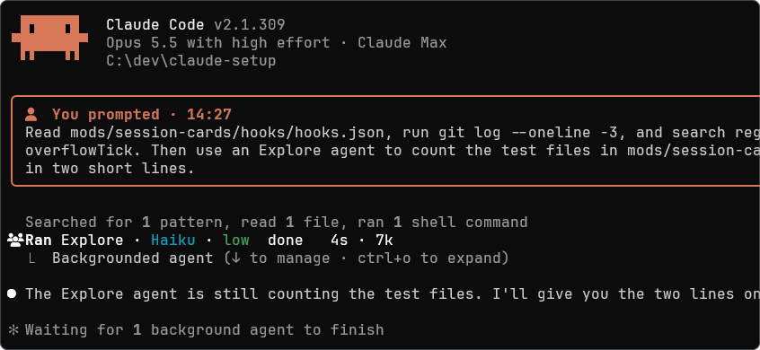
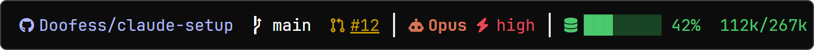

<a href="https://doofess.github.io/Doofess/">
  <picture>
    <source media="(prefers-color-scheme: dark)" srcset="assets/header-dark.svg">
    <source media="(prefers-color-scheme: light)" srcset="assets/header-light.svg">
    
  </picture>
</a>

Full-stack developer and system designer in Israel, currently looking for opportunities. I build desktop and web apps with TypeScript, React and Rust.

  <a href="https://doofess.github.io/Doofess/"><picture><source media="(prefers-color-scheme: dark)" srcset="assets/button-portfolio-dark.svg"><source media="(prefers-color-scheme: light)" srcset="assets/button-portfolio-light.svg"></picture></a>
  <a href="https://www.linkedin.com/in/rotem-grinhut-979547262/"><picture><source media="(prefers-color-scheme: dark)" srcset="assets/button-linkedin-dark.svg"><source media="(prefers-color-scheme: light)" srcset="assets/button-linkedin-light.svg"></picture></a>
  <a href="https://x.com/Rotemgr"><picture><source media="(prefers-color-scheme: dark)" srcset="assets/button-x-dark.svg"><source media="(prefers-color-scheme: light)" srcset="assets/button-x-light.svg"></picture></a>

These projects are built with AI coding agents. I make the design and UX/UI decisions, review the code and test by hand. Each README has the architecture, the decisions behind it and how it is tested.

## Projects

### Inwire

Desktop packet analyzer for Windows. The app runs without administrator rights; a separate service holds the capture handle and streams frames over a named pipe. The packet list is virtualised by hand and stays smooth during heavy live capture.

Built with Electron, React, TypeScript and Rust. [Repository](https://github.com/Doofess/inwire) · [How it works (PDF)](https://github.com/Doofess/inwire/blob/main/docs/how-inwire-works.pdf)

### GymBro

Appointment booking system for gyms, Hebrew first and right to left: an Android app for members and staff, a Windows app for staff, one API. Postgres refuses a double booking with an exclusion constraint, and a concurrency test proves it. The source is private; the repository documents the system.

Built with TypeScript, Kotlin, PostgreSQL, Electron and React. [Architecture and screenshots](https://github.com/Doofess/gymbro)

### Marshell

Windows app for AI coding-agent CLIs from any vendor. It gives Claude Code, Codex and others a session list with live status, approval cards and searchable history, while each agent stays a plain terminal. A Rust core serves the React UI over a local HTTP and WebSocket API.

Built with Tauri 2, Rust, React and TypeScript. [Repository](https://github.com/Doofess/marshell) · [Alpha release](https://github.com/Doofess/marshell/releases/tag/v0.1.0-alpha.1)

### claude-setup

My coding-agent setup, kept as code. It holds the skills, subagents and hooks described above, and one installer makes every Windows PC the same.

Built with Python, PowerShell and TypeScript. [Repository](https://github.com/Doofess/claude-setup)

## How I work with agents

**Plans and passes.** Each feature starts as a short spec and a step-by-step plan in .md files. A main session hands the steps to subagents and runs the tests itself after each one, because an agent's summary of its own work is not proof that the work is correct.

**Review before merge.** A pull request is merged only after a code review of its latest commit, with every finding checked against the code. I wrote a skill and a hook for this, and the hook refuses the merge until that review is recorded.

**Models, cache and context.** The model is matched to the task and usually kept for the whole session, since switching it throws away the prompt cache. Sessions tend to stay on one task, and the context is cleared before anything unrelated so that an old conversation does not pull the model off course.

**Tools per project.** Plugins, MCP servers, language servers and skills are switched on only in the projects that use them, because many of them add to the context on every turn and cost tokens whether they are used or not.

The full write-up, including the two subagents I wrote and why, is on the [portfolio page](https://doofess.github.io/Doofess/#work).

## What I build with

**Interface:** React, TypeScript, Vite, Tailwind CSS 
**Desktop and mobile:** Electron, Tauri 2, Kotlin, Jetpack Compose 
**Services and data:** Rust, Node.js, PostgreSQL, Supabase, SQLite 
**Tooling:** GitHub Actions, Vitest, Playwright, Python, PowerShell

## Activity

  <picture>
    <source media="(prefers-color-scheme: dark)" srcset="https://streak-stats.demolab.com?user=Doofess&background=0D1117&border=3D444D&stroke=3D444D&ring=4493F8&fire=4493F8&currStreakNum=F0F6FC&sideNums=F0F6FC&currStreakLabel=9198A1&sideLabels=9198A1&dates=9198A1&border_radius=6&disable_animations=true">
    <source media="(prefers-color-scheme: light)" srcset="https://streak-stats.demolab.com?user=Doofess&background=FFFFFF&border=D1D9E0&stroke=D1D9E0&ring=0969DA&fire=0969DA&currStreakNum=1F2328&sideNums=1F2328&currStreakLabel=59636E&sideLabels=59636E&dates=59636E&border_radius=6&disable_animations=true">
    
  </picture>
  <picture>
    <source media="(prefers-color-scheme: dark)" srcset="https://github-readme-stats.vercel.app/api/top-langs/?username=Doofess&layout=compact&langs_count=6&card_width=350&bg_color=0D1117&title_color=F0F6FC&text_color=9198A1&border_color=3D444D&border_radius=6&custom_title=Languages%20in%20public%20repos&disable_animations=true">
    <source media="(prefers-color-scheme: light)" srcset="https://github-readme-stats.vercel.app/api/top-langs/?username=Doofess&layout=compact&langs_count=6&card_width=350&bg_color=FFFFFF&title_color=1F2328&text_color=59636E&border_color=D1D9E0&border_radius=6&custom_title=Languages%20in%20public%20repos&disable_animations=true">
    
  </picture>

<picture>
  <source media="(prefers-color-scheme: dark)" srcset="https://github-readme-activity-graph.vercel.app/graph?username=Doofess&bg_color=0D1117&color=9198A1&line=4493F8&point=F0F6FC&area=true&area_color=4493F8&title_color=F0F6FC&radius=6&hide_border=true&custom_title=Contributions%2C%20last%2031%20days">
  <source media="(prefers-color-scheme: light)" srcset="https://github-readme-activity-graph.vercel.app/graph?username=Doofess&bg_color=FFFFFF&color=59636E&line=0969DA&point=1F2328&area=true&area_color=0969DA&title_color=1F2328&radius=6&hide_border=true&custom_title=Contributions%2C%20last%2031%20days">
  
</picture>

## Contact

[LinkedIn](https://www.linkedin.com/in/rotem-grinhut-979547262/). Hebrew and English. The [portfolio page](https://doofess.github.io/Doofess/) has more on each project.
