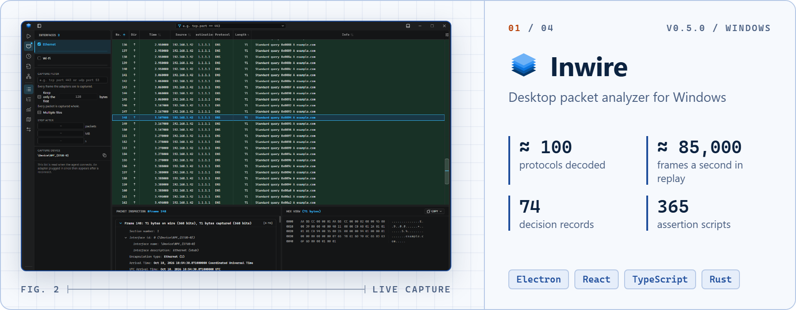
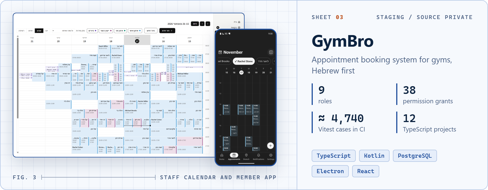
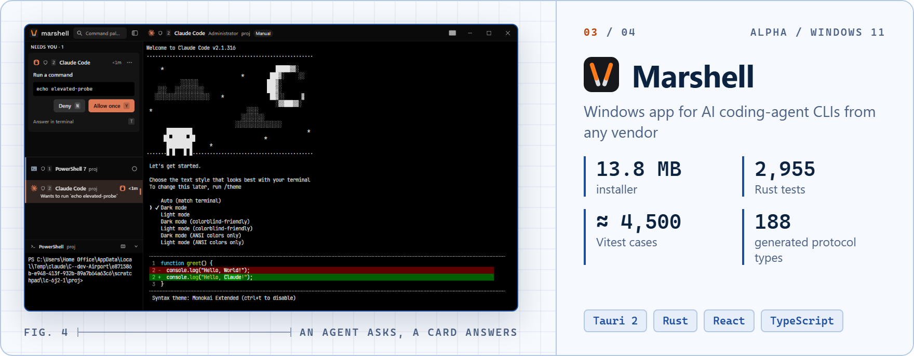
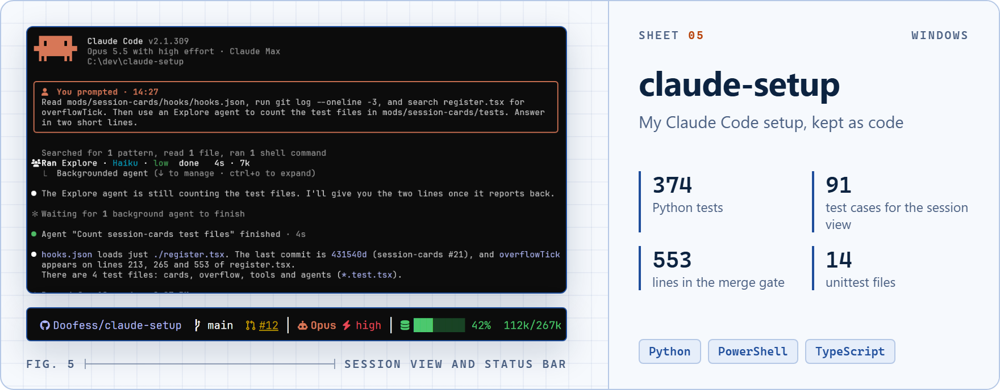
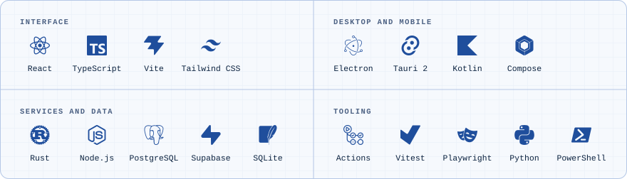

<a href="https://doofess.github.io/Doofess/">
  <picture>
    <source media="(prefers-color-scheme: dark)" srcset="assets/banner-dark.svg">
    <source media="(prefers-color-scheme: light)" srcset="assets/banner-light.svg">
    
  </picture>
</a>

Full-stack developer and system designer in Israel, currently looking for opportunities. I build desktop and web apps with TypeScript, React and Rust.

  <a href="https://doofess.github.io/Doofess/"><picture><source media="(prefers-color-scheme: dark)" srcset="assets/button-portfolio-dark.svg"><source media="(prefers-color-scheme: light)" srcset="assets/button-portfolio-light.svg"></picture></a>
  <a href="https://www.linkedin.com/in/rotem-grinhut-979547262/"><picture><source media="(prefers-color-scheme: dark)" srcset="assets/button-linkedin-dark.svg"><source media="(prefers-color-scheme: light)" srcset="assets/button-linkedin-light.svg"></picture></a>
  <a href="https://x.com/Rotemgr"><picture><source media="(prefers-color-scheme: dark)" srcset="assets/button-x-dark.svg"><source media="(prefers-color-scheme: light)" srcset="assets/button-x-light.svg"></picture></a>

These projects are built with AI coding agents (Claude Code). I make the design and UX/UI decisions, review the code and test by hand. Each README has the architecture, the decisions behind it and how it is tested.

## Projects

<a href="https://github.com/Doofess/inwire">
  <picture>
    <source media="(prefers-color-scheme: dark)" srcset="assets/card-inwire-dark.png">
    <source media="(prefers-color-scheme: light)" srcset="assets/card-inwire-light.png">
    
  </picture>
</a>

**[Inwire](https://github.com/Doofess/inwire).** Desktop packet analyzer for Windows. The app runs without administrator rights; a separate service holds the capture handle and streams frames over a named pipe. The packet list is virtualised by hand and stays smooth during heavy live capture.

Built with Electron, React, TypeScript and Rust. [Repository](https://github.com/Doofess/inwire) · [How it works (PDF)](https://github.com/Doofess/inwire/blob/main/docs/how-inwire-works.pdf)

<a href="https://github.com/Doofess/gymbro">
  <picture>
    <source media="(prefers-color-scheme: dark)" srcset="assets/card-gymbro-dark.png">
    <source media="(prefers-color-scheme: light)" srcset="assets/card-gymbro-light.png">
    
  </picture>
</a>

**[GymBro](https://github.com/Doofess/gymbro).** Appointment booking system for gyms, Hebrew first and right to left: an Android app for members and staff, a Windows app for staff, one API. Postgres refuses a double booking with an exclusion constraint, and a concurrency test proves it. The source is private; the repository documents the system.

Built with TypeScript, Kotlin, PostgreSQL, Electron and React. [Architecture and screenshots](https://github.com/Doofess/gymbro)

<a href="https://github.com/Doofess/marshell">
  <picture>
    <source media="(prefers-color-scheme: dark)" srcset="assets/card-marshell-dark.png">
    <source media="(prefers-color-scheme: light)" srcset="assets/card-marshell-light.png">
    
  </picture>
</a>

**[Marshell](https://github.com/Doofess/marshell).** Windows app for AI coding-agent CLIs from any vendor. It gives Claude Code, Codex and others a session list with live status, approval cards and searchable history, while each agent stays a plain terminal. A Rust core serves the React UI over a local HTTP and WebSocket API.

Built with Tauri 2, Rust, React and TypeScript. [Repository](https://github.com/Doofess/marshell) · [Alpha release](https://github.com/Doofess/marshell/releases/tag/v0.1.0-alpha.1)

<a href="https://github.com/Doofess/claude-setup">
  <picture>
    <source media="(prefers-color-scheme: dark)" srcset="assets/card-claude-setup-dark.png">
    <source media="(prefers-color-scheme: light)" srcset="assets/card-claude-setup-light.png">
    
  </picture>
</a>

**[claude-setup](https://github.com/Doofess/claude-setup).** My Claude Code configuration as code, with a hook that refuses to merge a pull request until its latest commit has been reviewed.

Built with Python, PowerShell and TypeScript. [Repository](https://github.com/Doofess/claude-setup)

## What I build with

<picture>
  <source media="(prefers-color-scheme: dark)" srcset="assets/stack-dark.svg">
  <source media="(prefers-color-scheme: light)" srcset="assets/stack-light.svg">
  
</picture>

## Activity

  <picture>
    <source media="(prefers-color-scheme: dark)" srcset="https://streak-stats.demolab.com?user=Doofess&background=0B1A30&border=2C4F82&stroke=2C4F82&ring=8FBAFF&fire=FFB454&currStreakNum=EAF2FF&sideNums=EAF2FF&currStreakLabel=8FBAFF&sideLabels=8FBAFF&dates=9FB6D8&border_radius=12">
    <source media="(prefers-color-scheme: light)" srcset="https://streak-stats.demolab.com?user=Doofess&background=F6F9FD&border=B5C8E6&stroke=B5C8E6&ring=1F4E9C&fire=B8430B&currStreakNum=0C2340&sideNums=0C2340&currStreakLabel=1F4E9C&sideLabels=1F4E9C&dates=4C6183&border_radius=12">
    
  </picture>
  <picture>
    <source media="(prefers-color-scheme: dark)" srcset="https://github-readme-stats.vercel.app/api/top-langs/?username=Doofess&layout=compact&langs_count=6&card_width=350&bg_color=0B1A30&title_color=EAF2FF&text_color=9FB6D8&border_color=2C4F82&border_radius=12&custom_title=Languages%20in%20public%20repos">
    <source media="(prefers-color-scheme: light)" srcset="https://github-readme-stats.vercel.app/api/top-langs/?username=Doofess&layout=compact&langs_count=6&card_width=350&bg_color=F6F9FD&title_color=0C2340&text_color=4C6183&border_color=B5C8E6&border_radius=12&custom_title=Languages%20in%20public%20repos">
    
  </picture>

<picture>
  <source media="(prefers-color-scheme: dark)" srcset="https://github-readme-activity-graph.vercel.app/graph?username=Doofess&bg_color=0B1A30&color=9FB6D8&line=8FBAFF&point=FFB454&area=true&area_color=8FBAFF&title_color=EAF2FF&radius=12&hide_border=true&custom_title=Contributions%2C%20last%2031%20days">
  <source media="(prefers-color-scheme: light)" srcset="https://github-readme-activity-graph.vercel.app/graph?username=Doofess&bg_color=F6F9FD&color=4C6183&line=1F4E9C&point=B8430B&area=true&area_color=1F4E9C&title_color=0C2340&radius=12&hide_border=true&custom_title=Contributions%2C%20last%2031%20days">
  
</picture>

## Contact

[LinkedIn](https://www.linkedin.com/in/rotem-grinhut-979547262/). Hebrew and English. The [portfolio page](https://doofess.github.io/Doofess/) has more on each project.
